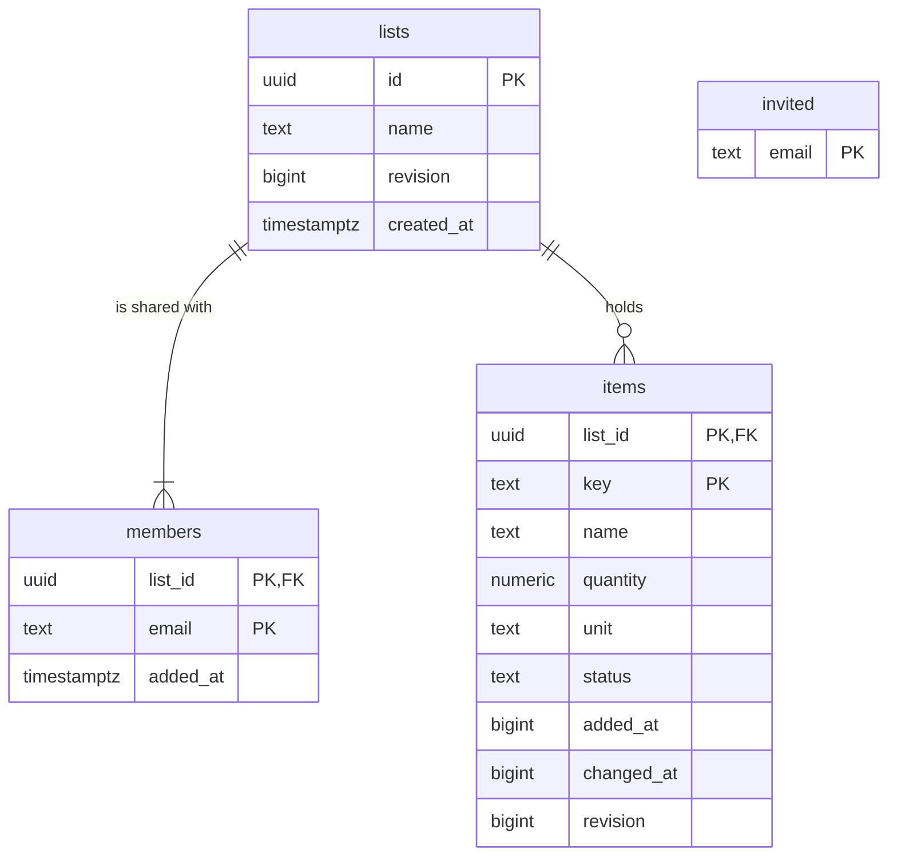

# Data model

The Supabase project holds four tables, which `supabase/migrations` defines. The apps read them through the functions described below, never by writing to them.

A list always has at least one member: removing its last member deletes it, along with its items. `invited` stands apart from the other tables. Nothing refers to it, and it refers to nothing.

## lists

* `id` is made by the database.
* `name` is "Shopping list" for every list the database makes. No function renames a list yet.
* `revision` counts the changes made to the list. Each change a device sends, and each change to the members, raises it by one.
* `created_at` decides which list the apps show when an account belongs to two lists with as many members.

## members

* `email` is the address the member signs in with, in lower case. Membership goes by address rather than by account, so a list can be shared with someone who has never signed in.
* `added_at` orders the members as the apps list them.

## items

An item is identified by its list and its key. Its row stays when it leaves the list, so that its going reaches the other devices, and so that the apps can suggest it when a name is typed again.

* `key` is the name in lower case, with each run of spaces made one and the ends trimmed, so "Oat milk" and "oat  milk " are one item. The device that first adds the item works the key out.
* `name` is the name as it was last written, up to 100 characters.
* `quantity` is how many or how much to buy, a number above zero such as 2 or 0.5, or null when none is given.
* `unit` is what `quantity` counts, up to 20 characters, or null when there is none. It may be a unit of measure, such as `g`, `lb` or `cup`, or any word for how the item comes, such as `loaves` or `box`. Either may be given without the other: "2 loaves", "3", "a box" and "500 g" are all quantities.
* `status` is one of:
  * `needed`, still to buy;
  * `bought`, ticked off;
  * `removed`, taken off the list without being bought.

  The apps show bought items after the needed ones, the most recently ticked first, so that a tick made by mistake is easy to find and undo. For a bought item, `changed_at` is when it was ticked.
* `added_at` is when the item last went onto the list, in milliseconds since the epoch, by the clock of the device that added it.
* `changed_at` is when the item last changed, in milliseconds since the epoch, by the clock of the device that changed it. Of two changes to an item, the one with the later `changed_at` wins.
* `revision` is the list's revision when the item last changed. A device asks for the items whose revision is above the last one it saw.

## invited

* `email` is an address that may start a list of its own, in lower case. An account that signs in, belongs to no list and is invited is given a new list. An account that is not invited can use a list only once a member shares it.

The project's owner keeps this table, from the Supabase dashboard. The API cannot read or write it.

## Functions

* `my_lists()` returns the caller's lists, each with its members, the one the apps show first. It makes a list for an invited caller who has none.
* `sync(list, since, changes)` takes a device's changed items and returns the list's revision, its members, and the items changed since the revision `since`.
* `add_member(list, member)` shares a list with an email address.
* `remove_member(list, member)` stops sharing a list with an address, which may be the caller's own.

The three that take a list fail unless the caller is one of its members. The errors the apps act on carry codes of their own: `CA001` for an account that is not invited, `CA002` for a caller who is not a member, and `CA003` for an address that is not one.
